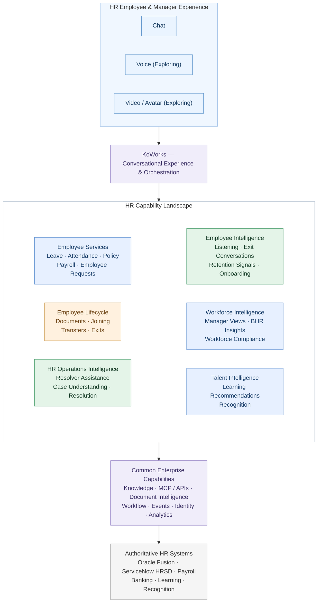

# CS360 — HR Capability Assessment

**Working Draft | 13 November 2026**  
**Scope:** Original 37 CS360 HR functional asks (F-01–F-37).  
**Purpose:** Organize the asks into reusable capabilities and assess each independently for AI inferencing, conversational experience, and workflow dependence.

## 1. Executive view

The CS360 requirements combine three different needs:

- **Strong AI fit:** Inference, interpretation, summarization, recommendations or natural conversation materially improve the outcome.
- **Hybrid:** Conversation or document intelligence adds value, but the underlying outcome relies on deterministic rules, APIs or workflows.
- **Workflow-led:** The principal requirement is a transaction, approval, validation or status update. AI may simplify access, but is not essential.

**Important:** A chat interface does not, by itself, make a transaction a strong AI use case. The assessment below is preliminary, not a feasibility or delivery commitment.

## 2. High-level capability landscape

Voice and video are **horizontal interaction options under exploration**, not separate HR business capabilities or production-ready commitments. They should reuse the same underlying skills, knowledge and workflows as chat.

## 3. Capability families and coverage

| Capability family | What it covers | Existing foundation / reuse | Nature of AI opportunity |
|---|---|---|---|
| **1. Employee Intelligence** | Exit conversations, employee listening and signals, retention opportunities, first-90-day onboarding guidance, avatar conversations | Employee Connect | Strong inference and conversation fit |
| **2. Workforce Intelligence** | Manager team views, BHR dashboards, workforce analysis, rotation and mandatory leave exceptions | Workforce data and HR Analytics foundations | Strong for insights; rules for compliance |
| **3. Talent Intelligence** | Learning recommendations, recognition support | Recruit AI skills/matching concepts where reusable | Selective inference and recommendations |
| **4. Employee Services** | Leave, attendance, policies, payroll, letters, profile, nominations, salary account | Oracle Fusion, HRSD, Payroll | Strong for policy interpretation and service discovery; otherwise hybrid/workflow |
| **5. Employee Lifecycle** | Ex-employee letters, KYC and document checks, joining, conversions, transfers, probation, offboarding, F&F | Oracle Fusion, HRSD, document systems | Document AI plus workflow orchestration |
| **6. HR Operations Intelligence** | HR case summarization, knowledge retrieval, recommended resolutions and response drafting | ServiceNow HRSD | Strong contextual AI fit |

The original 37 asks remain intact. The six families are a proposed organizational view, not new business requirements.

## 4. All 37 functional asks — AI fit assessment

Each ask is assessed on **three independent dimensions**:

- **Inferencing:** Value from AI interpreting unstructured information, understanding context, detecting signals, summarizing or recommending (not merely retrieving a known answer).
- **Chat experience:** Value from employees or HR staff expressing needs and receiving guidance through natural language. Voice/video can extend this where suitable.
- **Workflow:** Degree to which delivering the ask depends on deterministic transactions, rules, approvals, status changes or cross-system orchestration.

**High / Medium / Low** indicates relative opportunity or dependence, not implementation readiness. A High workflow rating is not a negative judgment; it identifies the primary execution mechanism. The **AI fit** column is retained as an overall qualitative assessment.

| ID | Original ask | Capability family | Inferencing | Chat experience | Workflow | AI fit | Rationale |
|---|---|---|---|---|---|---|---|
| F-01 | Show leave balance | Employee Services | Low | High | Low | Workflow-led | Retrieve authoritative balances; chat is optional. |
| F-02 | Apply for leave | Employee Services | Low | High | High | Workflow-led | Eligibility and submission are deterministic transactions. |
| F-03 | Approve leave | Employee Services | Low | Medium | High | Workflow-led | Manager approval and delegation are established workflows. |
| F-04 | Mark attendance | Employee Services | Low | Low | High | Workflow-led | Attendance capture and reminders rely on rules and APIs. |
| F-05 | Raise regularisation | Employee Services | Low | Medium | High | Workflow-led | Exception identification and request submission are rule-driven. |
| F-06 | Approve regularisation | Employee Services | Low | Medium | High | Workflow-led | Policy guardrails, authority and cut-offs determine outcome. |
| F-07 | LOP and absence advisor | Employee Services | Medium | High | High | Hybrid | AI explains patterns/options; LOP rules and escalation are deterministic. |
| F-08 | Sick, maternity and paternity leave guidance | Employee Services | Medium | High | High | Hybrid | Conversation clarifies eligibility and documentation; workflow remains authoritative. |
| F-09 | Policy Advisor | Employee Services | High | High | Low | **Strong AI** | Contextual natural-language policy answers grounded in approved sources. |
| F-10 | Salary hold and reversal | Employee Services | Medium | High | High | Hybrid | AI explains causes and next steps; payroll executes controlled transactions. |
| F-11 | Service Suggestor | Employee Services | High | High | Medium | **Strong AI** | Infer intent and route to the correct HR service. |
| F-12 | Letters on request | Employee Services | Low | High | High | Workflow-led | Templates, generation, verification and delivery are automatable without inference. |
| F-13 | Ex-employee roles/responsibilities letters | Employee Lifecycle | Low | Medium | High | Workflow-led | Identity, clearance and approvals dominate. |
| F-14 | Update profile | Employee Services | Low | High | High | Workflow-led | Validated Oracle field updates are transactions. |
| F-15 | Payslip and pay questions | Employee Services | Medium | High | Low | Hybrid | Explanation of deductions/arrears adds value; figures come from payroll. |
| F-16 | Form 16 and tax questions | Employee Services | Medium | High | Low | Hybrid | Retrieval is routine; grounded conversational explanation adds value. |
| F-17 | Nomination update | Employee Services | Low | High | High | Workflow-led | Eligibility, validation and record updates are rule-driven. |
| F-18 | Salary account opening and conversion | Employee Services | Low | Medium | High | Workflow-led | CRN validation, banking workflow and payroll deadlines dominate. |
| F-19 | Name, DOB and address corrections / KYC | Employee Lifecycle | High | Medium | High | Hybrid | AI extraction and comparison assist; verification and updates follow rules. |
| F-20 | Education and certification upgrades | Employee Lifecycle | High | Medium | High | Hybrid | Extract qualification evidence; approvals and updates remain deterministic. |
| F-21 | PAN changes and new-hire PAN | Employee Lifecycle | Medium | Medium | High | Hybrid | Extraction and matching assist; PAN verification is authoritative. |
| F-22 | D0–E0 conversion and contract extension | Employee Lifecycle | Low | Medium | High | Workflow-led | Employment conversion is a governed approval/transaction workflow. |
| F-23 | New-joiner documents | Employee Lifecycle | High | Medium | High | Hybrid | Document reading and exception detection; checklist/storage are workflows. |
| F-24 | D0 onboarding | Employee Lifecycle | High | Medium | High | Hybrid | Document intelligence at scale; bulk onboarding is orchestration. |
| F-25 | Transfers and position management | Employee Lifecycle | Low | Medium | High | Workflow-led | Position checks, approvals and Oracle updates are rule-driven. |
| F-26 | Probation confirmation | Employee Lifecycle | Low | Medium | High | Workflow-led | Deadlines, assessments, approvals and letters are workflow needs. |
| F-27 | Offboarding | Employee Lifecycle | Low | Medium | High | Workflow-led | Clearances, handovers and departmental tasks need orchestration. |
| F-28 | Full and final settlement | Employee Lifecycle | Medium | High | High | Hybrid | AI explains components; calculations and clearances are deterministic. |
| F-29 | Exit conversation and Kontinue retention agent | Employee Intelligence | High | High | Medium | **Strong AI** | Conversational listening, theme/sentiment inference, summaries and retention signals. |
| F-30 | Manager team view | Workforce Intelligence | Medium | High | Medium | Hybrid | Data views/actions are deterministic; AI interprets trends and priorities. |
| F-31 | Learning suggestions | Talent Intelligence | High | High | Medium | **Strong AI** | Infer needs and recommend learning from role/skills context. |
| F-32 | Reward and recognition | Talent Intelligence | Medium | High | High | Hybrid | AI may help compose recognition; eligibility/awards follow workflows. |
| F-33 | Onboarding buddy — first 90 days | Employee Intelligence | High | High | Medium | **Strong AI** | Contextual Q&A, check-ins, feedback interpretation and guidance. |
| F-34 | Avatar companion | Employee Intelligence | Medium | High | Low | **Strong AI** | Voice/video guided onboarding and pulse interaction; modality alone does not imply inference. |
| F-35 | AI resolver assist | HR Operations Intelligence | High | High | Medium | **Strong AI** | Case summaries, grounded resolution suggestions and response drafting. |
| F-36 | BHR dashboards | Workforce Intelligence | High | High | Low | **Strong AI** | Conversational workforce analysis, comparisons and interpretation. |
| F-37 | Staff rotation and mandatory leave alerts | Workforce Intelligence | Low | Medium | High | Workflow-led | Compliance thresholds and alerts must be deterministic; AI may explain exceptions. |

### How to interpret the three dimensions

- **F-01 Leave balance:** Low inferencing, High chat, Low workflow — an employee can naturally ask a question, but the answer is a straightforward read from Oracle.
- **F-09 Policy Advisor:** High inferencing, High chat, Low workflow — interpreting a policy question and producing a grounded answer are the core value.
- **F-19 KYC corrections:** High inferencing, Medium chat, High workflow — document interpretation can benefit from AI, while verification and record updates require controlled processes.
- **F-29 Exit conversation:** High inferencing, High chat, Medium workflow — conversational listening and signal extraction are central, with follow-up routing as supporting workflow.
- **F-34 Avatar companion:** Medium inferencing, High chat, Low workflow — a video or avatar interface is primarily an interaction modality; inference depends on the actual conversation use case.

### Classification summary

| Classification | Count | Interpretation |
|---|---:|---|
| **Strong AI** | **9** | Inference or natural-language interaction materially contributes to value. |
| **Hybrid** | **13** | AI improves interpretation, guidance or document handling alongside workflows. |
| **Workflow-led** | **15** | Rules, integration, transactions and approvals are the primary solution. |
| **Total** | **37** | All F-01–F-37 included. |

## 5. Where to concentrate AI investment

| Opportunity | Relevant asks | Distinctive AI contribution |
|---|---|---|
| Employee listening and signals | F-29, F-33, F-34 | Interpret conversations, identify themes and support engagement. |
| HR knowledge and service discovery | F-09, F-11 | Grounded answers and intent-based service discovery. |
| HR resolver intelligence | F-35 | Case understanding, summaries and resolution recommendations. |
| Workforce intelligence | F-30, F-36 | Conversational interpretation of metrics and trends. |
| Learning intelligence | F-31 | Role- and skill-aware recommendations. |
| Document understanding | F-19–F-21, F-23–F-24 | Extraction, matching and exception identification. |

The remaining requirements are important, but should primarily reuse or extend enterprise workflows, exposed through convenient interfaces where beneficial.

## 6. Positioning chat, voice and video

| Interaction | Strong initial candidates | Position |
|---|---|---|
| Chat | Policy Advisor, Service Suggestor, Resolver Assist, BHR insights | Natural interface for grounded information and reasoning. |
| Voice | Exit conversations, onboarding check-ins, guided enquiries | Explore when spoken dialogue improves participation/accessibility. |
| Video / Avatar | F-34 and selected onboarding journeys | Explore where visual interaction improves experience. |
| Conventional UI / workflow | Leave approvals, attendance, payroll actions, document submission | Retain structured forms, controls and confirmation where appropriate. |

**Design principle:** Voice and video should be reusable interaction layers over the same HR skills and systems, rather than separate implementations. Video/avatar interaction should not be confused with employee-camera analysis.

## 7. Suggested positioning for HR stakeholders

The 37 CS360 asks should not be treated as 37 independent AI use cases. Our preliminary assessment identifies **9 strong AI opportunities, 13 hybrid opportunities and 15 primarily workflow-led requirements**.

The strongest AI opportunities are concentrated in employee intelligence, policy understanding, service discovery, workforce analysis, learning recommendations and HR resolver assistance. Other asks benefit mainly from workflow automation and better integration with Oracle Fusion, ServiceNow HRSD, Payroll and related systems.

The recommended next step is to validate this classification with HR, identify existing capabilities that can be reused, and separately assess integration prerequisites, feasibility, ownership and delivery priority.

> **Central proposition:** Build reusable HR capabilities and apply AI where inference or conversation changes the outcome—not simply because a workflow can be exposed through chat.

---

*Assessment note: This document intentionally focuses on the original functional asks, capability coverage and AI fit. It excludes the broader ongoing Employee Buddy concept, sensitivity ratings, delivery estimates and unvalidated production-readiness claims.*
